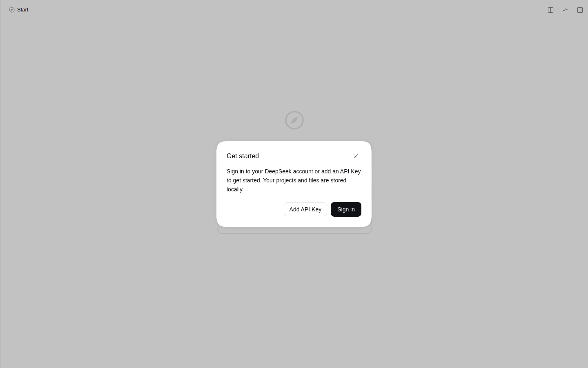
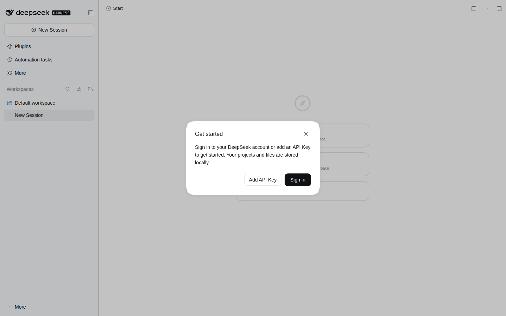

# dsh-rightbar-max-keep-rail

把 DeepSeek Harness 右侧边栏的**「面板全屏」**改成**覆盖会话区、保留左侧会话列表栏**：全屏面板从左侧栏右缘开始铺到窗口右缘，不再连同会话列表一起盖住。

真 GUI（1440×900，先把插件注入的样式关掉、再打开，其余一切不动）：

| 原生：全屏面板盖住左侧会话列表 | 装了本插件：全屏面板只覆盖会话区，左侧栏还在 |
|---|---|
|  |  |

纯插件实现：**不改 core 一行代码**，浏览器半零依赖、零构建（`lib/client.js` 就是发布产物，不需要打包）。

## 一、问题：原生「面板全屏」是全窗口，不是会话区

右侧栏的「面板全屏」（词条 `command.fullscreen` = 面板全屏／退出全屏，快捷键命令 `pane.fullscreen.toggle`）在宿主里写死成 100vw：

| 证据 | 位置 | 内容 |
|---|---|---|
| 宽度与标记 | `packages/client/ui-sidebar-right/src/client/shell/SidebarRight.tsx:342` | `width: fullscreen ? '100vw' : width`；`'--dsh-sidebar-width': fullscreen ? '100vw' : ...`；`data-sidebar-right-panel={fullscreen ? 'fullscreen' : 'push'}` |
| 定位 | `.../shell/SidebarRight.module.css:31` | 面板是 `position: absolute; top/right/bottom: 0`，全屏时 `--dsh-dockkit-dock-layer: 40`（普通面板 20） |
| 唯一的例外 | `.../shell/SidebarRight.module.css:93` | `[data-windows-titlebar] .panel[data-sidebar-right-panel='fullscreen'] { max-width: calc(100vw - var(--dsh-windows-sidebar-width)) }` |
| 那个变量是什么 | `packages/client/ui-layout/src/client/AppFrame.tsx:294` | `--dsh-windows-sidebar-width` = `cols.sidebar` px = **左侧栏列宽** |

也就是说：**「覆盖会话、保留左栏」正是 Windows 桌面端全屏的样子**（它有一条 `max-width` 例外），而 Web 构建没有这条规则，全屏面板 100vw 把左侧栏一起盖住。本插件就是把这条规则搬到所有构建。

## 二、实现：一条样式 + 一次量宽

```
全屏面板宽度 = 100vw − 左侧栏宽
```

面板靠 `right: 0` 定位，减掉左栏宽之后自然从右侧往左铺，左缘正好落在会话列表栏的右缘——不推挤、不重排，左侧栏保持原样。

1. **样式**（`lib/client.js` 的 `CSS_TEXT`，注入一份 `<style>`）：

   ```css
   [data-sidebar-right-panel="fullscreen"] {
     width: calc(100vw - var(--dsh-keeprail-left, 0px)) !important;
     max-width: none !important;                     /* 盖掉 Windows 那条 max-width */
     --dsh-sidebar-width: calc(100vw - var(--dsh-keeprail-left, 0px)) !important;
   }
   ```

   必须 `!important`：宿主的宽度与 `--dsh-sidebar-width` 都是**内联**写的（`SidebarRight.tsx:342` 的 `style` 对象），普通样式表规则压不过内联声明。

2. **量宽**：`--dsh-keeprail-left` 写在 `<html>` 上，面板通过继承拿到。值来自 frame 网格第一列——`grid-template-columns` 的计算值已经是解析后的 px 列表（`AppFrame.tsx:294` 写入的 `「${cols.sidebar}px minmax(...) minmax(0, Npx)」`），第一段就是左栏实际占宽。

3. **跟随变化**：左栏能被拖宽、被折叠、在窄屏变成抽屉（`data-sidebar-drawer`），窗口也能改大小，所以**全屏期间**用 `requestAnimationFrame` 逐帧采样（每帧一次 `getComputedStyle`，只在值变化时写变量）；面板一消失就停。触发用 `MutationObserver` 只订四个属性：`data-rightbar-fullscreen`、`data-sidebar-collapsed`、`data-sidebar-drawer`（frame 上）、`data-sidebar-right-panel`（面板上）。

4. **只认已发布的 DOM 契约**：所有选择器都是 `ui-sidebar-right` / `ui-layout` 的数据属性，没有一个 CSS-module 哈希类名。宿主若改了属性，插件退化成「什么都不做」，不会把界面弄坏。

折叠左栏与窄屏抽屉都算 0：这两种形态下左侧栏不占列（折叠无轨道、抽屉是浮层），留白反而是错的。

## 三、安装

```sh
dsh plugin --profile web add dsh-rightbar-max-keep-rail     # 装进当前 profile
# 或本地目录（开发时）
dsh plugin --profile web add /path/to/dsh-rightbar-max-keep-rail
```

装完**重启 dsh**（插件行在启动时装配）。用右侧边栏顶部那个「面板全屏」按钮进出全屏即可，按钮、快捷键、布局动画都还是原生那套。

## 四、验证

1. **单元测试** `npm test`（11 条全过）：

   ```sh
   cd dsh-rightbar-max-keep-rail && npm test
   ```

2. **真 GUI 端到端**：在临时 `DSH_HOME` 里 `dsh plugin --profile web add .` → 起实例 → 无头 Chromium 打开 GUI → 新建会话 → 开右侧栏 → 点「全屏」，然后在同一个页面里把插件注入的 `<style>` 置 `disabled` 再恢复，对比同一次全屏：

   | 状态 | 面板左缘 | 面板宽 | 视口 | 左栏轨道 | `--dsh-keeprail-left` |
   |---|---|---|---|---|---|
   | 原生（样式关掉） | 0 | 1440 | 1440 | 280px | 280px |
   | 插件生效 | **280** | **1160** | 1440 | 280px | 280px |
   | 再恢复 | 280 | 1160 | 1440 | 280px | 280px |

   即全屏面板的左缘精确等于左栏右缘（280 = 280），宽度 = 视口 − 左栏；反复开关不残留布局。这一段同时证明浏览器半在真宿主里被加载并执行（`<style>` 存在、变量被写入、面板几何随之变化）。

3. **浏览器夹具**：`test/fixture.html` 按上面那两处 DOM 契约复刻了 frame 三列网格 + `position:absolute; width:100vw` 的全屏面板，覆盖 GUI 里不方便手点的状态（拖宽左栏、折叠、窄屏抽屉、退出再进全屏）。

   夹具用无头 Chromium 按真实尺寸打开，插件按与宿主一致的方式从 `window.__ModuleLoader__` 挂载，逐状态量面板矩形：

   ```sh
   python3 -m http.server 8793 --bind 127.0.0.1      # 在插件目录里
   pw eval --width 1280 --height 800 --wait-for "#done" \
     "http://127.0.0.1:8793/test/fixture.html" --js "document.getElementById('out').textContent"
   ```

1280×800 下实测（`panelX` = 面板左缘，`gapToRail` = 面板左缘 − 左栏右缘）：

| 状态 | panelX | 面板宽 | 左栏宽 | gapToRail |
|---|---|---|---|---|
| 未装插件（原生） | 0 | 1280 | 264 | −264（盖住左栏） |
| 装上插件 | 264 | 1016 | 264 | **0** |
| 把左栏拖到 320 | 320 | 960 | 320 | **0** |
| 左栏折叠 | 0 | 1280 | 0（无轨道） | 0（不留白） |
| 左栏变抽屉（窄屏） | 0 | 1280 | 0（浮层） | 0（不留白） |
| 退出全屏 | 860 | 420 | 264 | —（回到原生内联宽度） |
| 再进全屏 | 264 | 1016 | 264 | **0** |

1024×720 复测同一组数字按比例成立（264/760、320/704），页面无 console 报错。

## 五、已知限制（诚实清单）

- **宿主改属性即失效**：面板靠 `data-sidebar-right-panel="fullscreen"` 认，frame 靠 `data-rightbar-fullscreen` 认。`0.2.2-rc.1` 实测存在；将来改名则插件静默不生效（不会报错、不会破坏布局）。
- **`max-width: none` 是覆盖性的**：它盖掉 Windows 桌面端那条 `max-width`。宽度已经算成「视口 − 左栏」，再让一次会窄一截，所以这里选择不重叠。
- **移动端**：窄屏下自动化全屏由视口宽度推导，左栏此时是抽屉，插件算出 0，行为与原生一致（覆盖全屏）——这不是 bug，是没有左栏可保留。
- **未接真实模型会话**：真 GUI 端到端用的是空会话（没登录、没有 API Key），只验证布局与插件装载；对话流式过程中反复进出全屏只由 rAF 采样保证跟随，没有在长会话里压测过。

## 文档修订记录

| 日期 | 修订 |
|---|---|
| 2026-11-12 | 0.1.1：截图改为 `screenshot-<序号>-<说明>.png` 命名并补 `screenshots.json`（按顺序列出两张展示图，供插件市场与 awesome-dsh-plugin 收录展示）。代码未变。 |
| 2026-11-11 | 0.1.0：首版。全屏面板宽度改为「100vw − 左栏宽」，rAF 采样跟随左栏拖动/折叠/抽屉；11 条单测、真 GUI 端到端（280/1160 对 0/1440）、无头 Chromium 夹具量像素全部通过。 |

## License

MIT
